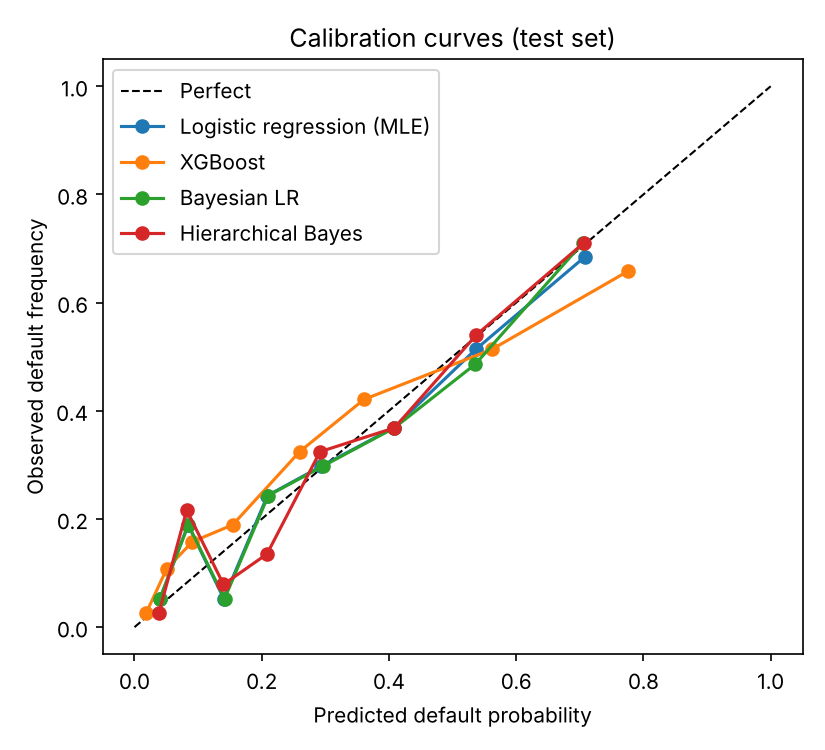
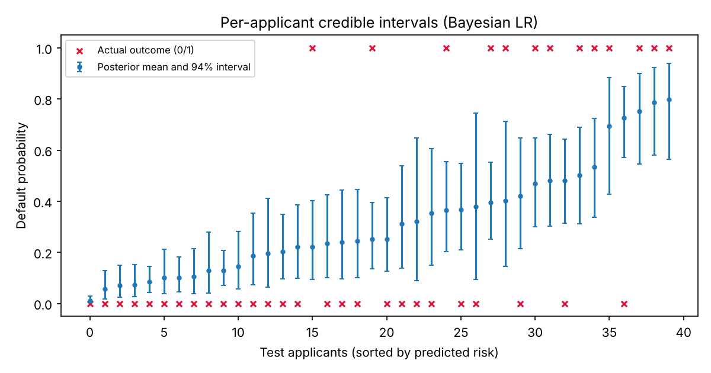
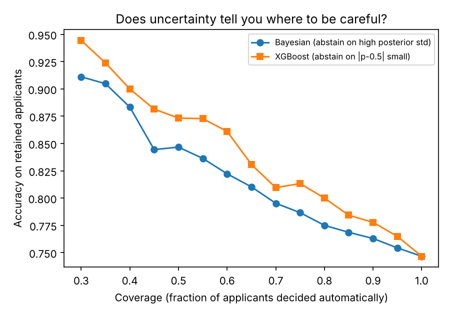
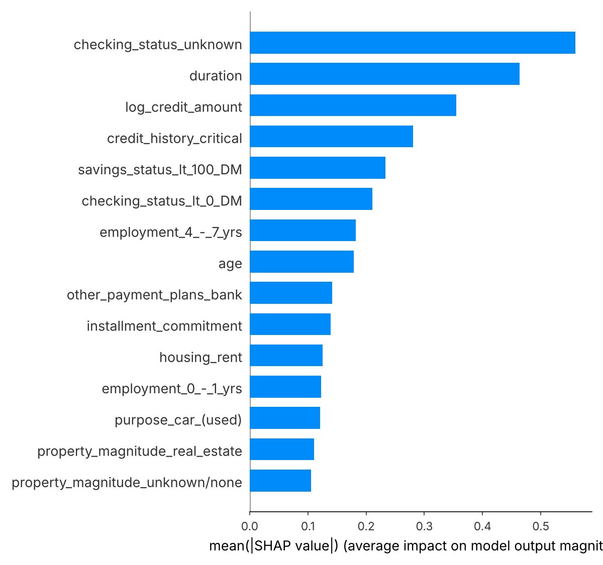

# Bayesian Credit Risk Modelling

Bayesian logistic regression and a hierarchical model for credit default, compared against an XGBoost baseline on the public **German Credit** dataset (UCI / OpenML `credit-g`, 1,000 applicants).

The question this project answers: **a single accuracy number (for example, the 97.8% reported in our earlier XGBoost paper) says nothing about how sure the model is about each applicant.** A Bayesian treatment gives a full posterior over default probability for every applicant, so we can see calibration, credible intervals, and where the model should abstain.

## What is in here

| Model | Purpose |
|---|---|
| XGBoost | Baseline, explained with SHAP |
| Logistic regression (MLE) | Frequentist reference |
| Bayesian logistic regression | Weakly-informative Normal priors, full posterior over all coefficients |
| Hierarchical Bayesian logistic regression | Partial pooling across **loan purpose** (varying intercept and varying slope on loan duration), non-centred parametrisation |

Evaluation covers accuracy, AUC, Brier score, log loss, expected calibration error (ECE), calibration curves, per-applicant credible intervals, and a selective-prediction analysis ("if the model abstains on its most uncertain applicants, does accuracy on the rest improve?").

## Quick start

```bash
python -m venv .venv
source .venv/bin/activate          # Windows: .venv\Scripts\activate
pip install -r requirements.txt

python -m src.run_all --data german --out results
python -m src.bootstrap --out results
python -m src.ablation --out results
```

If OpenML is unreachable, `src/data.py` falls back to `data/credit.csv` (see `data/README.md`). Run all commands from the repository root with `python -m ...` (not `python src/run_all.py`), because the modules use relative imports.

Runtime is a few minutes on a laptop (about 2 minutes on one CPU core). Dependency versions used for the reported results are pinned in `requirements.txt`. Use `--draws 500 --tune 500 --chains 2` for a quick run.

`--data synthetic` generates a fake dataset with the same schema. It is only for checking that the pipeline runs offline; do not report its numbers.

## Outputs (`results/`)

- `metrics.csv`: accuracy, AUC, Brier, log loss, ECE for every model
- `diagnostics.json`: R-hat, effective sample size, divergences, uncertainty diagnostics
- `posterior_summary_*.csv`: posterior means, standard deviations and 94% intervals
- `selective_prediction.csv`: accuracy versus coverage when abstaining on uncertain applicants
- `shap_top_features.csv` and `bayes_top_coefficients.csv`: feature importance, SHAP versus posterior coefficients
- `figures/`: `calibration.png`, `credible_intervals.png`, `selective_prediction.png`, `forest_bayes_lr.png`, `forest_group_intercepts.png`, `trace_hierarchical.png`, `shap_xgboost.png`

## Results

All numbers below come from one run on the real German Credit data (1,000 applicants, 30% default), 70/30 stratified split (700 train / 300 test), seed 42, 4 chains x 1,000 draws (1,000 tuning). Bracketed values are 95% bootstrap intervals over the 300 test applicants (`python -m src.bootstrap`). Because the test set is small, differences smaller than roughly 0.03 in AUC are within noise.

| Model | Accuracy | ROC-AUC | Brier | Log loss | ECE |
|---|---|---|---|---|---|
| Logistic regression (MLE) | 0.747 [0.697, 0.793] | 0.762 [0.699, 0.819] | 0.173 [0.150, 0.198] | 0.522 [0.462, 0.590] | 0.078 [0.057, 0.134] |
| Bayesian LR (posterior mean) | 0.747 [0.697, 0.793] | 0.763 [0.700, 0.819] | 0.173 [0.150, 0.198] | 0.521 [0.462, 0.588] | 0.080 [0.056, 0.133] |
| Hierarchical Bayes (posterior mean) | 0.750 [0.700, 0.797] | 0.780 [0.719, 0.836] | 0.166 [0.143, 0.191] | 0.505 [0.447, 0.571] | 0.094 [0.072, 0.145] |
| XGBoost | 0.747 [0.693, 0.793] | 0.782 [0.726, 0.836] | 0.170 [0.143, 0.197] | 0.511 [0.442, 0.586] | 0.058 [0.044, 0.116] |



### Answers to the five research questions

1. **Is Bayesian LR better calibrated than conventional LR?** No. With weakly-informative priors and 700 training rows the posterior mean is almost identical to the MLE: paired bootstrap differences in Brier, log loss and ECE all include zero (ECE difference -0.001, 95% CI [-0.017, 0.012]). The benefit of the Bayesian fit here is the uncertainty it provides (question 4), not better point predictions.
2. **Does hierarchical modelling help across loan purposes?** The hierarchical model beats the plain logistic regression on AUC (+0.018, CI [0.007, 0.029]), Brier (-0.007, CI [-0.010, -0.003]) and log loss (-0.017, CI [-0.027, -0.008]). **However, this is not evidence for partial pooling.** The plain models never see loan purpose. In an ablation (`python -m src.ablation`) a flat Bayesian LR with purpose dummies and no pooling performs the same as the hierarchical model (AUC 0.782 vs 0.780; paired differences all include zero). The gain comes from including purpose, not from pooling. The posterior also says purpose-level variation is modest and uncertain: `sigma_a` mean 0.40 (94% interval 0.04 to 0.93), `sigma_b` mean 0.16 (0.01 to 0.47).
3. **XGBoost versus the statistical models.** XGBoost has the highest AUC (0.782) and lowest ECE (0.058), but its intervals overlap heavily with the others and its difference from logistic regression is not significant (AUC +0.020, CI [-0.016, 0.056]). On this small tabular dataset a regularised linear model is competitive.
4. **Applicant-level uncertainty.** The mean width of the 94% credible interval for an applicant's default probability is 0.29, which is large. Applicants in the high-uncertainty half (posterior std above the median) are misclassified at 35.3% versus 15.3% in the low-uncertainty half (Spearman correlation between std and error 0.26).

   
5. **Selective prediction.** Abstaining on high-uncertainty applicants raises accuracy on the rest: Bayesian LR accuracy rises from 0.747 at full coverage to 0.847 at 50% coverage and 0.911 at 30% coverage. A simple confidence rule for XGBoost (abstain when the prediction is closest to 0.5) does as well or slightly better at every coverage level (0.873 at 50%, 0.944 at 30%), so posterior standard deviation is useful but not superior to plain predicted-probability confidence here. Both curves are noisy at low coverage, where only 90 to 150 applicants remain.

   

### Sampler health

Maximum R-hat 1.003 (Bayesian LR) and 1.003 (hierarchical); minimum bulk ESS 1,362 and 873; zero divergences in both models (`results/diagnostics.json`).

### Interpretation: SHAP versus posterior coefficients

Both methods agree on the most important signal: having no checking account (`checking_status_unknown`) is associated with lower default risk (posterior mean coefficient -1.28, 94% interval -1.76 to -0.79; top SHAP feature). Rankings differ elsewhere. Loan duration is the second most important SHAP feature but only 13th of 29 by posterior coefficient magnitude (mean +0.47, 94% interval 0.20 to 0.72, so longer loans carry higher risk). SHAP measures effect on model output across the data, while coefficient magnitudes depend on the one-hot reference category, so the two rankings are not directly comparable (`results/shap_top_features.csv`, `results/bayes_top_coefficients.csv`).



## Project layout

```
src/data.py       data loading and preprocessing (German Credit + synthetic fallback)
src/models.py     PyMC models, posterior prediction, XGBoost
src/evaluate.py   metrics, calibration, selective prediction, plots
src/run_all.py    end-to-end pipeline
src/bootstrap.py  bootstrap CIs and paired differences
src/ablation.py   partial pooling vs flat purpose-dummy model
results/          generated outputs
docs/             figures embedded in this README
data/             optional local copy of the dataset (data/credit.csv, not committed)
```

## Reproducing the reported numbers

The results above come from `python -m src.run_all --data german --out results` (seed 42, 4 chains x 1,000 draws, 1,000 tuning), followed by `python -m src.bootstrap --out results` and `python -m src.ablation --out results`. Package versions are pinned in `requirements.txt`. Sampling is seeded, but exact posterior values can differ slightly across platforms and library versions; the conclusions above should not.

## Method notes

- Numeric features are standardised; `credit_amount` is log-transformed. Categorical features are one-hot encoded (first level dropped for the linear models).
- Priors: intercept `Normal(0, 2.5)`, coefficients `Normal(0, 1)` on standardised inputs. Hierarchical scales use `HalfNormal`.
- Posterior predictive probabilities are computed per applicant over all draws; "uncertainty" is the posterior standard deviation of the default probability.
- 70/30 stratified train/test split, fixed seed.

## Pooling ablation

`python -m src.ablation` compares the hierarchical model with a flat Bayesian LR that has purpose dummies but no pooling (`results/ablation_pooling.json`):

| Model | Accuracy | ROC-AUC | Brier | Log loss | ECE |
|---|---|---|---|---|---|
| Flat Bayesian LR + purpose dummies | 0.750 | 0.782 | 0.165 | 0.501 | 0.069 |
| Hierarchical Bayes | 0.750 | 0.780 | 0.166 | 0.505 | 0.094 |

Hierarchical minus flat, 95% bootstrap CI: AUC -0.003 [-0.010, 0.005], Brier +0.001 [-0.002, 0.004], log loss +0.004 [-0.003, 0.011]. All include zero.

## Limitations

- German Credit is small (1,000 rows). The Bayesian and frequentist estimates will be close; the value is in the uncertainty, not in beating XGBoost on accuracy.
- The test set has 300 applicants, so metric differences are noisy; results come from a single split and a single seed, not repeated cross-validation.
- Posterior uncertainty here is parameter uncertainty under the model. It does not capture model misspecification.
- The same pipeline can be pointed at Home Credit or Give Me Some Credit by writing a loader that returns a `CreditData` object (see `src/data.py`). Those datasets are much larger, so use a subsample or variational inference for the hierarchical model.